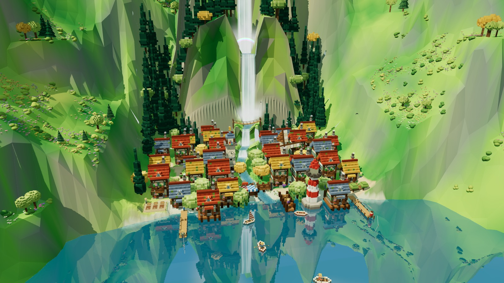

# 体素山谷村

一个用 React、TypeScript 和 Three.js 制作的 3D 体素村庄。在湖畔、农田和瀑布之间自由漫游，照料菜地，或在西岸栈桥抛竿钓鱼。收获可放进仓库并出售，进度保存在当前浏览器。



## 本地启动

需要 Node.js 22.12 或更高版本、npm，以及支持 WebGL 2 的浏览器。

克隆仓库并启动：

```bash
git clone https://github.com/ChaoJiTuoLuKING/voxel-village.git
cd voxel-village
npm ci
npm run dev
```

`npm run dev` 启动成功后，终端会显示 `Local:` 地址。请在运行项目的同一台电脑上，用浏览器打开 [http://127.0.0.1:5174/](http://127.0.0.1:5174/)。

访问期间请保持开发服务运行。按 `Ctrl+C` 停止服务后，需要重新执行 `npm run dev` 才能访问这个地址。

## 操作

- 普通视角下，拖拽旋转镜头，滚轮缩放。点击工具栏的「视角」切换预设机位。
- 切到「自由视角」后，可用 WASD 或方向键平移、Q 和 E 升降。鼠标右键拖拽也可平移。
- 点击「菜地」播种、浇水和采收。点击「钓鱼」进入西岸栈桥，按面板提示甩竿、提竿和收线。
- 按 P 暂停，H 隐藏界面，V 切换机位，Esc 退出当前交互。

## 构建与检查

```bash
npm run typecheck
npm test
npm run build
npm run preview
```

构建产物位于 `projects/voxel-village/dist/`。预览地址为 [http://127.0.0.1:6174](http://127.0.0.1:6174)。

安装 Google Chrome 后，运行 `npm run test:e2e` 可执行浏览器测试。

## 源码入口

- `projects/voxel-village/src/app/` 是界面和样式。
- `projects/voxel-village/src/scene/` 是场景初始化和每帧更新入口。
- `projects/voxel-village/src/features/` 是村民、地形、水面、相机、种田和钓鱼等模块。
- `packages/scene-kit/` 和 `packages/react-scene/` 负责 Three.js 渲染生命周期及 React 挂载。

## 许可证

本项目采用 [MIT 许可证](LICENSE)。
